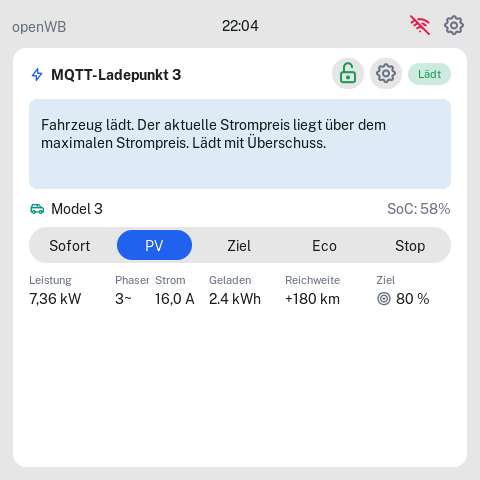
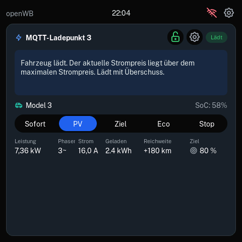
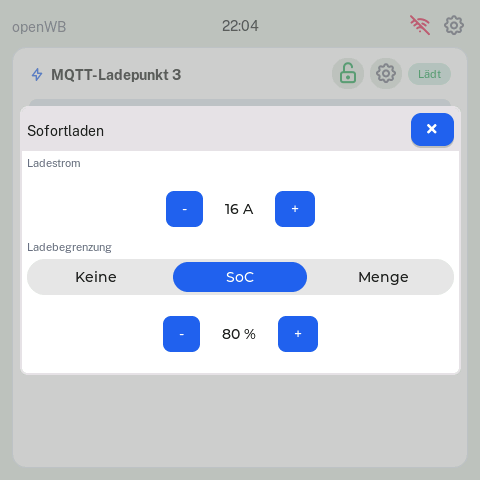

# openwb-simple-display

[](https://github.com/seaspotter/openwb-display/actions/workflows/build.yml)

Ein kleines ESP32-S3-Touchscreen-Display für [openWB](https://openwb.de/)-Ladestationen:
Ladepunkt-Status auf einen Blick, Touch-/Wisch-Steuerung von Lademodus, Ladestrom und
Sperrzustand, eine lokale Weboberfläche für Geräteeinstellungen sowie browserbasierte
(ohne Toolchain) Firmware-Installation und -Updates.

**Dies ist kein offizielles Produkt der openWB GmbH & Co. KG.** Der Autor arbeitet jedoch
eng mit dem openWB-Team zusammen und entwickelt auch darüber hinaus Software für das
Projekt.

<p align="center">
  
  
  
</p>

📖 **[Projektseite](https://seaspotter.github.io/openwb-display/)** ·
**[Vollständige Anleitung](https://seaspotter.github.io/openwb-display/anleitung/)**

## Status

Funktional vollständig und auf echter Hardware im Dauerbetrieb getestet: Live-Status
aller konfigurierten Ladepunkte, Touch-Steuerung (Lademodus, Ladestrom, Ladebegrenzung,
Eco-Preis, Sperren), lokale Weboberfläche, browserbasierte Erstinstallation und Updates
(mit signierter Firmware und automatischem Rollback), sowie ein automatischer
Hell/Dunkel-Wechsel nach Uhrzeit oder Sonnenstand. Noch vor dem ersten getaggten
Release — siehe [`docs/`](docs/) für die Installationsseite (sobald unter GitHub Pages
veröffentlicht).

## Hardware

- **Guition ESP32-4848S040C** — ESP32-S3, 4″ 480×480 IPS-Touch-Panel (ST7701S RGB/DPI,
  GT911 kapazitiver Touch), USB-C-Stromversorgung. Aktuell das einzig unterstützte Board.

## Softwarevoraussetzungen (deine openWB-Installation)

- openWB2 (aktuelle, MQTT/Python-basierte Software). Das Display verbindet sich direkt
  mit dem MQTT-Broker von openWB und liest/schreibt über dessen eigene
  `simpleAPI`-MQTT-Themen (`openWB/simpleAPI/...`), die von openWBs eigenem
  `simpleAPI_mqtt.py`-Daemon bereitgestellt werden — standardmäßig bei jeder
  Standard-Installation aktiv, keine Konfiguration auf openWB-Seite nötig.

## Bauen

Dies ist ein [PlatformIO](https://platformio.org/)-Projekt. Es verwendet ein
Git-Submodul für die Board-Definition — also mit `--recurse-submodules` klonen, oder
nach einem einfachen Klon `git submodule update --init` ausführen.

```sh
pio run -e guition_4848s040c          # bauen
pio run -e guition_4848s040c -t upload  # über USB-C flashen
pio test -e native_test                 # Host-seitige Unit-Tests ausführen
```

Die meisten Nutzer werden davon nichts brauchen — sobald veröffentlicht, ist das Flashen
eines fertigen Release ein Ein-Klick-Browser-Install über die GitHub-Pages-Seite des
Projekts, mittels [ESP Web Tools](https://esphome.github.io/esp-web-tools/) (Web Serial,
nur Chrome/Edge).

### Die Oberfläche ohne Hardware ansehen

Derselbe `src/ui/*`-Code, den die Firmware verwendet, lässt sich auch als
Desktop-Programm bauen — nützlich, um Layout-/Theme-/Text-Änderungen zu prüfen, bevor
echte Hardware angefasst wird:

```sh
pio run -e sim_screenshot && .pio/build/sim_screenshot/program   # rendert jeden
                                                                   # Screen nach
                                                                   # src/sim/out/*.bmp

pio run -e sim_interactive && .pio/build/sim_interactive/program [--multi]  # echtes
                                                               # Fenster, Maus = Touch;
                                                               # benötigt libsdl2-dev
```

## Tests

Vier native (hostseitige, ohne Hardware laufende) Testsuiten unter `test/`, alle über
`pio test -e native_test` ausführbar:

- `test_config_store` — NVS-Konfigurationsspeicher: Laden, Speichern, Zurücksetzen
- `test_openwb_mqtt` — MQTT-Themen-Parsing (Topic-Suffix → Statusfeld) gegen reale,
  live vom Broker aufgezeichnete Nutzlasten
- `test_sun_times` — Sonnenauf-/untergang-Berechnung (Sommer-/Wintersonnenwende,
  Zeitfenster- und Sonnenstand-Entscheidungslogik)
- `test_ota_manifest` — Update-Manifest-Parsing und -Validierung

Dazu läuft `pio run -e sim_screenshot` (siehe oben) bei jedem Build mit, als
Rendering-Vergleich jedes Bildschirms — fängt Layout-Regressionen, ohne reale Hardware
anzufassen. Alle vier Testsuiten sowie der Firmware-Build für die reale Hardware laufen
bei jedem Push automatisiert (siehe Build-Status-Badge oben).

## Projektstruktur

```
src/board/    Hardware-Bring-up: Display-Treiber, Touch-Treiber, Pin-Zuordnung
src/config/   Persistente Einstellungen (NVS), gemeinsam genutzt von Captive Portal
              und Web-UI
src/net/      WLAN-Einrichtung, Netzwerk-Task
src/openwb/   openWB-MQTT-Anbindung (Status-Abonnement + Steuerbefehle)
src/state/    Gemeinsamer App-Status zwischen Netzwerk-Task und UI-Task
src/ui/       LVGL-Screens, Widgets und das von quartz abgeleitete Theme
src/web/      Lokaler Web-Einstellungsserver (ESPAsyncWebServer) — einziger Ort für
              Einstellungen außer dem WLAN-Reset (siehe src/ui/wifi_reset_prompt.h)
src/ota/      Firmware-Update-Manager
src/sim/      Desktop-Screenshot-/Interaktiv-Tools (siehe "Die Oberfläche ansehen" oben)
              — werden nie in die echte Firmware eingebaut
test/         Native Unit-Tests (siehe "Tests" oben)
tools/        Font-/Icon-Asset-Erzeugung, Release-Paketierung
docs/         GitHub-Pages-Seite: Startseite, Anleitung, Web-Installer, Release-Manifeste
```

## Lizenz

MIT — siehe [`LICENSE`](LICENSE). Mitgelieferte Schriftarten und Icons stehen unter
eigenen Lizenzen; siehe `tools/fonts/source/LICENSE` und `tools/icons/source/LICENSE`.
